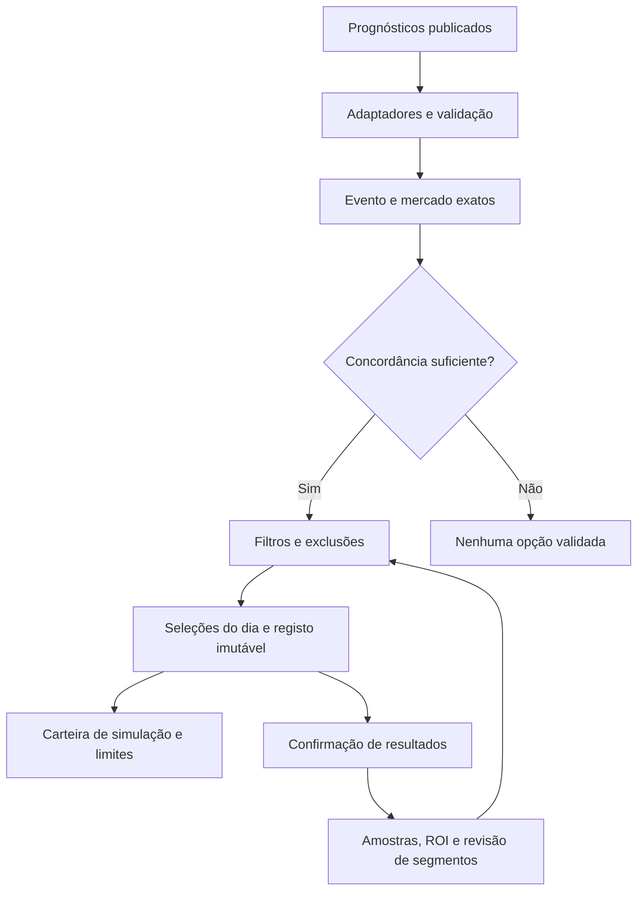

# Arquitetura do Mister Mi

O analista é um conjunto explícito de regras e verificações, com proveniência. O avatar dá identidade à experiência; não implica capacidades de previsão que ainda não foram medidas.

## Portas de qualidade

1. Dia corrente de Lisboa, timestamps com fuso e instante real da recolha.
2. Participantes compatíveis, género/sub-idade preservados, países conhecidos iguais e horários a no máximo 20 minutos.
3. Mesmo mercado: resultado regulamentar não é vencedor com prolongamento; total de golos não é cantos nem primeira parte.
4. Métrica explícita e limiar da fonte. Cada domínio conta uma vez.
5. Previsões qualificadas contraditórias no mesmo mercado impedem a seleção.
6. Pelo menos duas fontes, uma com início de jogo verificável. PredictZ só confirma.
7. Sem jogos iniciados ou a menos de cinco minutos do início. Dados com mais de 45 minutos são ocultados.
8. Exclusões e limites de odds; uma recomendação por identidade validada do evento.

## Contabilidade

O livro de recomendações guarda a primeira publicação, a configuração, o preço observado e a sua origem. Atualizações posteriores não melhoram retroativamente os preços nem eliminam derrotas. A odd selecionada é o menor preço observado entre as fontes qualificadas, de forma determinística; não é uma oferta executável garantida.

Taxa de acerto: vitórias / (vitórias + derrotas). ROI simulado: lucro em unidades / número de entradas liquidadas com odd. Sem odd, o resultado pode entrar na taxa de acerto mas não no ROI. Pendentes e devolvidas ficam separados. Os relatórios de uma unidade não são um extrato bancário nem refletem comissões; o simulador da banca é uma projeção separada para o dia atual.

O drawdown mede a queda máxima desde o pico da série de lucros em unidades na ordem de publicação dos registos. Não é uma curva de caixa marcada ao segundo, porque os eventos podem acabar em ordens diferentes.

## Revisão de segmentos

O painel agrupa por desporto, país, mercado e desporto × país. Apresenta amostra e intervalo de Wilson de 95%. Sinaliza revisão quando há pelo menos 30 entradas com preço, cobertura de odds de pelo menos 80% e ROI simulado inferior a −10%. Esses números são critérios de triagem ajustáveis, não testes de causalidade ou prova de rentabilidade futura. O utilizador pode excluir uma combinação sem reescrever o histórico.

## Risco de simulação

Política inicial ilustrativa: 0,5% da banca por jogo, 2% por dia e 1% por desporto/país/competição. A alocação é fixa e não usa a pontuação como probabilidade. Não há alavancagem, recuperação de perdas, Martingale, apostas automáticas ou múltiplas construídas pelo sistema. Jogos sem odd ficam fora da carteira. Categorias desconhecidas partilham um limite comum.

Ainda não há correlações estatísticas estimadas entre equipas, mercados ou competições. Os limites de concentração são aproximações de política, não uma matriz de risco validada. Posições externas e apostas reais do utilizador não são conhecidas.

## Próxima fase de investigação

1. Recolher histórico prospectivo suficiente com publicação anterior ao jogo e resultados verificáveis.
2. Separar treinos, calibração e teste por janelas cronológicas reais; evitar fuga de informação.
3. Comparar Brier score, log loss e curvas de calibração por segmento e baseline.
4. Só ativar valor esperado ou Kelly fracionado com probabilidade calibrada, preço recente executável e custos conhecidos.
5. Acrescentar dados abertos por competição, identificadores estáveis e testes de liquidação antes de alargar a cobertura.
